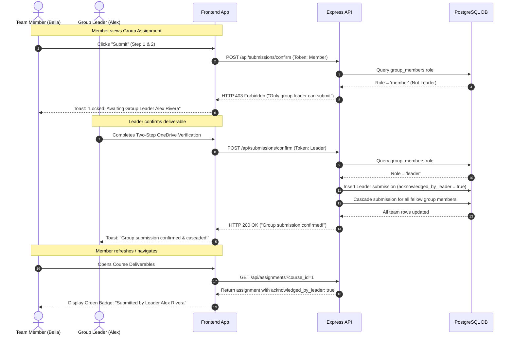
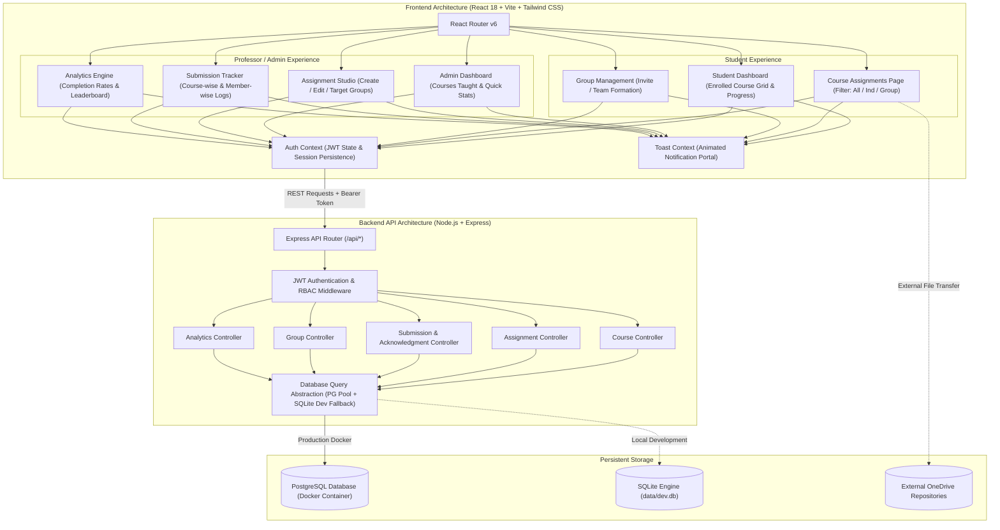
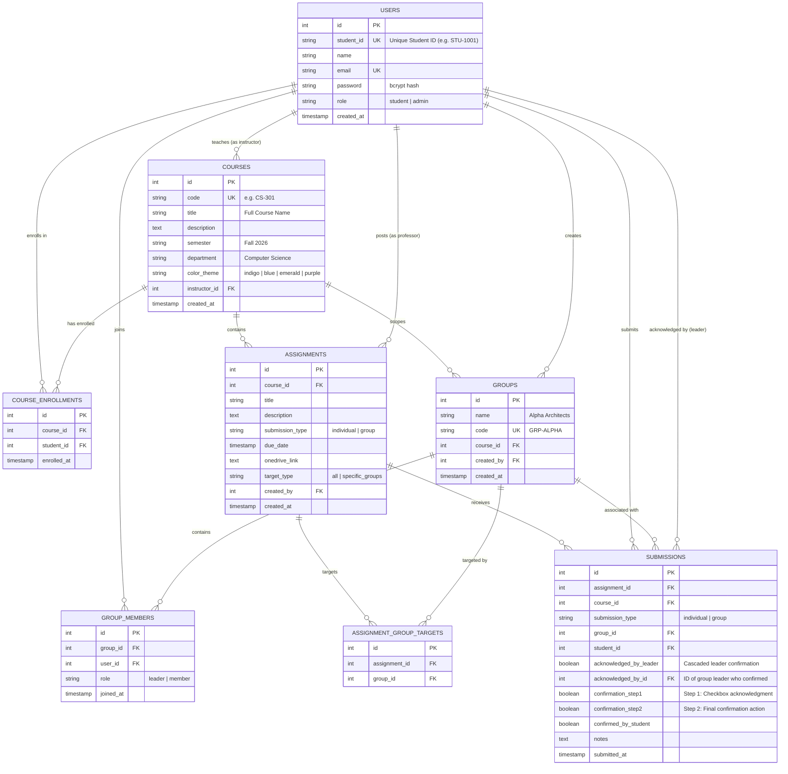

# Joineazy: Student, Group & Course Assignment Management System
## Round 2: Enhanced UI/UX, Course-Driven Architecture & Group Leader Workflow

A full-stack, enterprise-grade academic platform built with **React 18 + Tailwind CSS, Node.js + Express, and PostgreSQL** (containerized with **Docker**).

Designed for modern collaborative education, this system powers structured course enrollments, team formation, OneDrive deliverable tracking, a rigorous **two-step submission verification system**, and an automated **Group Leader Acknowledgment Workflow**.

---

## 📑 Table of Contents
1. [Round 2 Key Upgrades & UI/UX Philosophy](#1-round-2-key-upgrades--uiux-philosophy)
2. [Group Leader Acknowledgment Workflow](#2-group-leader-acknowledgment-workflow)
3. [System Architecture & Data Flow](#3-system-architecture--data-flow)
4. [Database Schema & ER Diagram](#4-database-schema--er-diagram)
5. [Role-Based Access & Feature Matrix](#5-role-based-access--feature-matrix)
6. [API Endpoint Documentation](#6-api-endpoint-documentation)
7. [Automated Testing & Quality Assurance](#7-automated-testing--quality-assurance)
8. [Setup & Run Instructions](#8-setup--run-instructions)
   - [Option A: One-Command Docker Run (Recommended)](#option-a-one-command-docker-run-recommended)
   - [Option B: Local Node.js Development](#option-b-local-nodejs-development)
9. [Pre-Seeded Demo Credentials](#9-pre-seeded-demo-credentials)

---

## 1. Round 2 Key Upgrades & UI/UX Philosophy

### 🎨 UI/UX Design Decisions & Rationale:

| Design Dimension | Implementation | Strategic Rationale |
|---|---|---|
| **Visual Hierarchy & Typography** | Clean typography powered by `Plus Jakarta Sans`, high-contrast heading scales (`text-2xl font-bold text-slate-900`), and subtle subtitle tracking (`text-slate-500`). | Eliminates visual fatigue during long grading and studying sessions. Ensures immediate legibility of critical deadlines. |
| **Color System** | Primary: **Indigo** (`#4F46E5`), Success: **Emerald** (`#10B981`), Warning: **Amber** (`#F59E0B`), Alert: **Rose** (`#F43F5E`), Neutral: **Slate** (`#0F172A`). | Provides universal semantic cues: green instantly communicates verified submissions, amber highlights pending leader actions, and indigo anchors primary navigation. |
| **Course-Centric Dashboard** | Responsive course grid featuring distinct course color badges, instructor metadata, total assignments, and individual completion progress bars. | Prevents academic clutter. Students can compartmentalize coursework per subject rather than sifting through an unorganized global feed. |
| **Granular Micro-Interactions** | Floating toast notification system (`ToastContext`), dynamic SVG loaders on form submission, animated progress rings, and hover lift effects (`hover:-translate-y-0.5`). | Replaces disruptive native browser `alert()` popups with polite, non-blocking asynchronous feedback, ensuring a polished consumer-grade experience. |
| **Inline Form Validation** | Real-time credential length check, email format regex validation, matching password confirmation, and 1-click demo login buttons. | Reduces friction during evaluation and daily student login, preventing avoidable round-trip API errors. |
| **Accessibility (a11y)** | Semantic HTML5 structure (`<main>`, `<nav>`, `<header>`, `<article>`), focus-visible ring outlines, explicit ARIA role designations, and WCAG AA contrast compliance. | Ensures inclusivity for screen readers and keyboard-only navigators across all viewports. |

---

## 2. Group Leader Acknowledgment Workflow

A critical academic problem in collaborative projects is ensuring group consensus and avoiding duplicate or conflicting student submissions. 

### 🛡️ The Joineazy Solution:

1. **Submission Type Scoping:** Every assignment is designated as either **Individual** (`individual`) or **Group** (`group`).
2. **Permission Guarding:**
   - **For Individual Assignments:** Any enrolled student can independently complete the 2-step verification and submit.
   - **For Group Assignments:** Only the **designated Group Leader** is authorized to confirm and submit deliverables for the entire group.
3. **Non-Leader Member State:**
   - Fellow team members see a locked submission state with an informative amber status badge:  
     `"Awaiting Group Leader Submission (Leader: <Leader Name>)"`.
   - Any direct API attempt by non-leaders to submit is rejected with **HTTP 403 Forbidden**.
4. **Group-Wide Synchronous Cascade:**
   - When the Group Leader completes the two-step verification and submits the OneDrive confirmation, the backend atomically creates/updates submission records for **all fellow group members**.
   - The submission status for all members instantly transitions to `"Submitted"`, with `acknowledged_by_leader = true` and `acknowledged_by_id = leader_id`.
   - Team members immediately see a green badge: `"Acknowledged & Submitted by Leader: <Leader Name>"`.



---

## 3. System Architecture & Data Flow



---

## 4. Database Schema & ER Diagram



---

## 5. Role-Based Access & Feature Matrix

| Feature | Student (Member) | Student (Group Leader) | Professor (Admin) |
|---|:---:|:---:|:---:|
| View Enrolled Courses & Progress | ✅ | ✅ | ❌ (Views Taught Courses) |
| Filter Assignments by Course & Type | ✅ | ✅ | ✅ |
| Submit Individual Assignments | ✅ | ✅ | ❌ |
| Submit Group Deliverables | ❌ (Locked) | ✅ (Cascades to Team) | ❌ |
| Create / Manage Groups | ✅ | ✅ | ✅ (Inspect & Audit) |
| Invite Members via Email / Student ID | ❌ | ✅ | ✅ |
| Create / Edit / Delete Courses & Assignments | ❌ | ❌ | ✅ |
| Target Assignments to Specific Teams | ❌ | ❌ | ✅ |
| Course-Wide Submission Tracking | ❌ | ❌ | ✅ |
| Department Analytics & Performance Leaderboard | ❌ | ❌ | ✅ |

---

## 6. API Endpoint Documentation

### Course Management (`/api/courses`)
| Method | Endpoint | Auth | Description |
|---|---|---|---|
| `GET` | `/api/courses` | Required | List courses (Enrolled with progress for students; Taught with stats for professors) |
| `GET` | `/api/courses/:id` | Required | Fetch course details, syllabus, assignments, and enrolled roster |
| `POST` | `/api/courses` | Admin | Create a new academic course |
| `POST` | `/api/courses/:id/enroll` | Required | Enroll student into a course |

### Assignments (`/api/assignments`)
| Method | Endpoint | Auth | Description |
|---|---|---|---|
| `GET` | `/api/assignments` | Required | Fetch assignments (supports `?course_id=X` query filter and attaches leader status) |
| `GET` | `/api/assignments/:id` | Required | Retrieve single assignment with OneDrive links and group targets |
| `POST` | `/api/assignments` | Admin | Create assignment with `course_id`, `submission_type` (`individual` \| `group`), and target groups |
| `PUT` | `/api/assignments/:id` | Admin | Modify assignment metadata, due dates, or group scope |
| `DELETE` | `/api/assignments/:id` | Admin | Delete assignment and cascade remove associated submissions |

### Submissions & Acknowledgment (`/api/submissions`)
| Method | Endpoint | Auth | Description |
|---|---|---|---|
| `POST` | `/api/submissions/confirm` | Student | Execute 2-step verification. Enforces Group Leader rule on group tasks; cascades to members |
| `GET` | `/api/submissions/tracker` | Admin | Group-wise & student-wise submission tracker with filter by course and assignment |
| `GET` | `/api/submissions/my` | Required | Fetch current user's personal submission records and timestamps |

### Groups (`/api/groups`)
| Method | Endpoint | Auth | Description |
|---|---|---|---|
| `GET` | `/api/groups/my` | Student | Fetch logged-in user's active groups and leadership status |
| `POST` | `/api/groups` | Student | Create new study group for a course (creator becomes group leader) |
| `POST` | `/api/groups/:groupId/members` | Leader/Admin | Add student to group using student email or student ID |
| `DELETE` | `/api/groups/:groupId/members/:userId` | Leader/Self | Remove student or leave group |

### Analytics (`/api/analytics`)
| Method | Endpoint | Auth | Description |
|---|---|---|---|
| `GET` | `/api/analytics/admin` | Admin | Cohort KPIs, completion percentage, course breakdown, and team ranking |
| `GET` | `/api/analytics/student` | Student | Personal course progress, upcoming milestones, and peer statistics |

---

## 7. Automated Testing & Quality Assurance

The system includes a dedicated 11-step integration test suite that tests the end-to-end user journeys, role-based security, and group leader cascade logic:

```bash
cd backend
npm test
```

### Verification Criteria Tested:
- [x] **Test 1:** Professor/Admin authentication via JWT.
- [x] **Test 2:** Course management API retrieval (CS-301, CS-402, CS-505).
- [x] **Test 3:** Student Leader authentication (Alex Rivera).
- [x] **Test 4:** Student Member authentication (Bella Chen).
- [x] **Test 5:** Student enrolled course progress computation (67%).
- [x] **Test 6:** Leader permission authorization on group tasks (`is_leader: true, can_submit: true`).
- [x] **Test 7:** Member restriction on group tasks (`is_leader: false, can_submit: false`).
- [x] **Test 8:** HTTP 403 Forbidden enforcement on non-leader submission attempts.
- [x] **Test 9:** Leader submission accepted via 2-step verification (HTTP 200/201).
- [x] **Test 10:** Immediate group-wide reflection & leader acknowledgment across all members (`acknowledged_by_leader = true`).
- [x] **Test 11:** Professor analytics summary and course-wise aggregation verification.

---

## 8. Setup & Run Instructions

### Option A: One-Command Docker Run (Recommended)

Run PostgreSQL, Node.js API, and Vite React Frontend seamlessly in isolated containers:

```bash
# 1. Clone the repository
git clone https://github.com/oubair777/StudentGroupManagement.git
cd StudentGroupManagement

# 2. Launch with Docker Compose
docker-compose up --build
```

- **Frontend Application:** `http://localhost:3000`
- **Backend API:** `http://localhost:5000/api`
- **PostgreSQL Database:** `localhost:5432`

---

### Option B: Local Node.js Development

#### 1. Backend Setup:
```bash
cd backend
npm install

# Run database seed to initialize users, courses, assignments & groups
npm run seed

# Start server (auto-detects PostgreSQL or seamlessly falls back to SQLite)
npm run dev
# Server will listen on http://localhost:5000
```

#### 2. Frontend Setup:
```bash
cd ../frontend
npm install

# Start Vite React development server
npm run dev
# Web application will open at http://localhost:3000
```

---

## 9. Pre-Seeded Demo Credentials

The login screen features **1-Click Quick Demo Login** buttons for instant evaluation:

| Role | Name | Email | Password | Details & Team Membership |
|---|---|---|---|---|
| **Professor (Admin)** | Dr. Robert Vance | `professor@joineazy.edu` | `admin123` | Department Chair; teaches CS-301, CS-402, CS-505 |
| **Student (Leader)** | Alex Rivera | `alex@joineazy.edu` | `student123` | **Leader** of *Alpha Architects* (Course: CS-301) |
| **Student (Member)** | Bella Chen | `bella@joineazy.edu` | `student123` | **Member** of *Alpha Architects* (Course: CS-301) |
| **Student (Leader)** | Charlie Davis | `charlie@joineazy.edu` | `student123` | **Leader** of *Beta Bytecrafters* (Course: CS-402) |
| **Student (Member)** | Diana Prince | `diana@joineazy.edu` | `student123` | **Member** of *Beta Bytecrafters* (Course: CS-402) |
| **Student (Solo/Unassigned)** | Evan Wright | `evan@joineazy.edu` | `student123` | Enrolled student exploring group formation |

---

*Submitted by: Mohammad Oubair Shareef (`oubairshareef7860@gmail.com`)*
