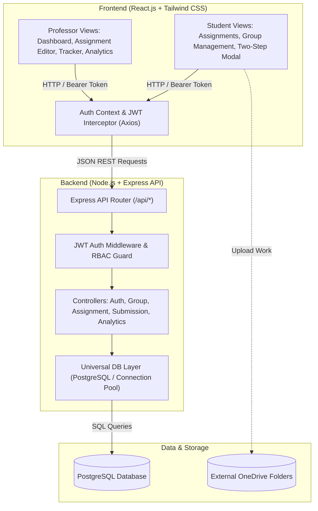
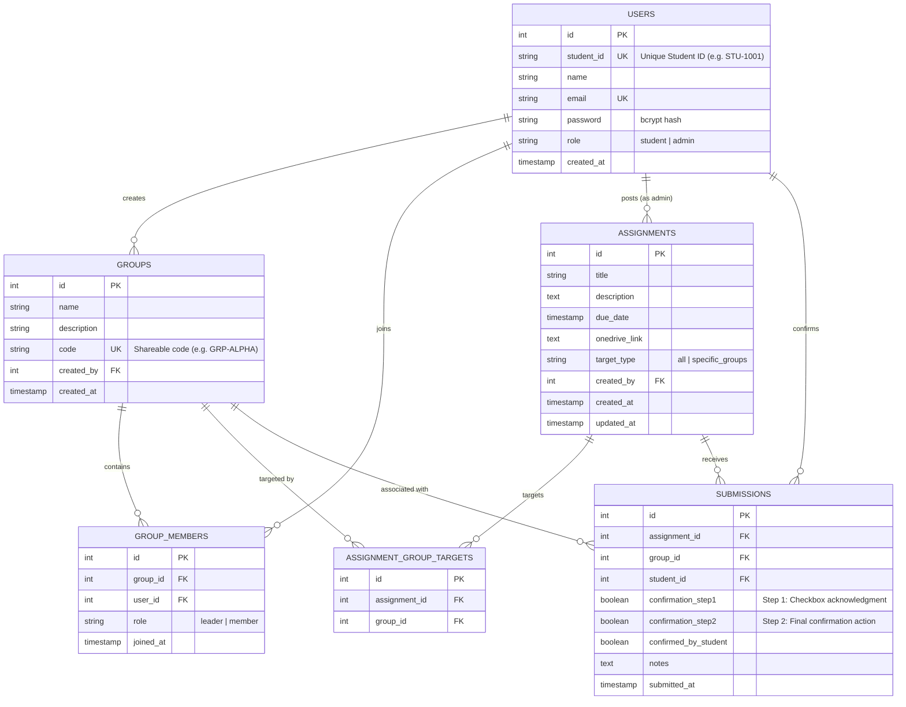

# Joineazy: Student, Group & Assignment Management System

A full-stack role-based academic platform built with **React.js + Tailwind CSS, Node.js + Express, and PostgreSQL** (containerized with **Docker**).

The system enables students to form collaborative groups, manage members, access OneDrive submission folders, and verify assignment deliverables via a strict **two-step verification workflow**. Meanwhile, professors (admins) manage assignments, target specific groups or the whole cohort, monitor group-wise and student-wise submission confirmations, and track analytics through an interactive dashboard.

---

## 📑 Table of Contents
1. [Overview of Implementation](#overview-of-implementation)
2. [Architecture Overview & Data Flow](#architecture-overview--data-flow)
3. [Database Schema & ER Diagram](#database-schema--er-diagram)
4. [Key Features & Role-Based Permissions](#key-features--role-based-permissions)
5. [API Endpoint Details](#api-endpoint-details)
6. [Setup & Run Instructions](#setup--run-instructions)
   - [Option A: Docker Compose (Recommended)](#option-a-docker-compose-recommended)
   - [Option B: Local Node.js Development](#option-b-local-nodejs-development)
7. [Key Design & Security Decisions](#key-design--security-decisions)
8. [Demo Credentials](#demo-credentials)

---

## 1. Overview of Implementation

### Problem Context:
At Joineazy, students collaborate in groups to complete academic assignments:
- **Professors** post assignments and share OneDrive submission links.
- **Students** form their own teams, invite group members via student email or ID, and confirm submissions once their work is uploaded externally.
- **Professors** monitor group-level and individual student progress via unified dashboards and analytics.

### Tech Stack:
- **Frontend:** React 18, Vite, Tailwind CSS, Lucide Icons, Axios, React Router v6.
- **Backend:** Node.js, Express.js, JWT Authentication, bcryptjs, RESTful Architecture.
- **Database:** PostgreSQL (with automated schema setup, indexing, and seamless local SQLite dev engine fallback).
- **DevOps & Containerization:** Docker, Docker Compose, Nginx.

---

## 2. Architecture Overview & Data Flow



---

## 3. Database Schema & ER Diagram



---

## 4. Key Features & Role-Based Permissions

### Student Role:
- **Authentication:** Secure registration & login with auto-assigned/custom student ID.
- **Group Formation:**
  - Create group with instant leadership privileges.
  - Invite/add fellow students using their **Academic Email** or **Student ID**.
  - Leave group or manage membership.
- **Assignment Access:**
  - View course-wide assignments and group-targeted assignments.
  - One-click launch to the designated **OneDrive submission folder**.
- **Two-Step Verification:**
  - **Step 1:** Confirm deliverable upload to OneDrive.
  - **Step 2:** Final confirmation action with optional notes/file references.
- **Visual Progress Tracking:**
  - Dynamic progress bars showing percentage of group members who verified submission.
  - Milestone completion badges (*"In Progress"*, *"High Momentum"*, *"Mastery Achieved"*).

### Professor (Admin) Role:
- **Assignment Management:**
  - Create, edit, and delete assignments with title, description, due date, and OneDrive link.
  - Target assignments to **All Students** or **Specific Groups** via multi-select checkboxes.
- **Submission Confirmation Tracker:**
  - **Group-Wise Tracker:** Overview of group size, confirmed counts, completion percentage, and team submission badge.
  - **Student-Wise Tracker:** Granular log of student names, student IDs, submission timestamps, two-step verification flags, and student notes.
- **Analytics & Performance Dashboard:**
  - Overall class submission rates and KPI summary cards.
  - Assignment-by-assignment submission progress bars.
  - Group performance ranking leaderboard with automated performance badges.

---

## 5. API Endpoint Details

### Authentication (`/api/auth`)
| Method | Endpoint | Access | Description |
|---|---|---|---|
| `POST` | `/api/auth/register` | Public | Register new student or admin |
| `POST` | `/api/auth/login` | Public | Authenticate user & return JWT token |
| `GET` | `/api/auth/profile` | Auth | Get logged-in user profile & joined groups |
| `GET` | `/api/auth/students` | Auth | Search student directory by name, email, or ID |

### Groups (`/api/groups`)
| Method | Endpoint | Access | Description |
|---|---|---|---|
| `POST` | `/api/groups` | Student | Create new group (creator becomes leader) |
| `GET` | `/api/groups/my` | Auth | Fetch user's current group(s) & member lists |
| `GET` | `/api/groups` | Auth | Fetch all groups (for professors & targeting) |
| `GET` | `/api/groups/:id` | Auth | Fetch single group details |
| `POST` | `/api/groups/:groupId/members` | Auth | Add member via student email or student ID |
| `DELETE` | `/api/groups/:groupId/members/:userId` | Auth | Remove member or leave group |

### Assignments (`/api/assignments`)
| Method | Endpoint | Access | Description |
|---|---|---|---|
| `GET` | `/api/assignments` | Auth | List assignments (filtered & personalized) |
| `GET` | `/api/assignments/:id` | Auth | Get single assignment details |
| `POST` | `/api/assignments` | Admin | Create assignment (all or specific groups) |
| `PUT` | `/api/assignments/:id` | Admin | Update assignment details & targets |
| `DELETE` | `/api/assignments/:id` | Admin | Delete assignment & related submissions |

### Submissions (`/api/submissions`)
| Method | Endpoint | Access | Description |
|---|---|---|---|
| `POST` | `/api/submissions/confirm` | Student | Confirm submission via 2-step verification |
| `GET` | `/api/submissions/tracker` | Admin | Group-wise & student-wise submission tracker |
| `GET` | `/api/submissions/my` | Auth | Get personal submission history |

### Analytics (`/api/analytics`)
| Method | Endpoint | Access | Description |
|---|---|---|---|
| `GET` | `/api/analytics/admin` | Admin | High-level metrics, completion charts & leaderboard |
| `GET` | `/api/analytics/student` | Student | Personal completion metrics & group progress |

---

## 6. Setup & Run Instructions

### Option A: Docker Compose (Recommended)
Runs PostgreSQL, Node.js Backend, and React Frontend in isolated containers with a single command:

```bash
# 1. Clone the repository
git clone <your-repo-url>
cd student-group-management

# 2. Start all services via Docker Compose
docker-compose up --build
```
- **Frontend:** `http://localhost:3000`
- **Backend API:** `http://localhost:5000/api`
- **PostgreSQL:** `localhost:5432`

---

### Option B: Local Node.js Development

#### 1. Backend Setup:
```bash
cd backend
npm install

# Start development server (auto-runs migrations and seeds initial data)
npm run dev
# Server will listen on http://localhost:5000
```
> **Note on Database:** The backend is configured to connect to PostgreSQL via `DATABASE_URL`. If a PostgreSQL server is not locally running, the backend seamlessly activates the built-in SQLite engine so you can evaluate the full application with zero friction!

#### 2. Frontend Setup:
```bash
cd ../frontend
npm install
npm run dev
# Frontend will listen on http://localhost:3000
```

---

## 7. Key Design & Security Decisions

1. **Role-Based Access Control (RBAC):**
   - JWT tokens include user role (`student` vs `admin`) and student identifier.
   - Server-side middleware guards (`verifyToken`, `requireStudent`, `requireAdmin`) ensure students cannot manipulate assignments or access private professor trackers.
2. **Strict Two-Step Submission Verification:**
   - Rather than an accidental single-click, submissions require explicit confirmation that files have been transferred to OneDrive followed by an intentional submission action.
3. **Targeted Assignment Scoping:**
   - Database model supports both general course-wide assignments and targeted group assignments through `assignment_group_targets`.
4. **Resilient Database Layer:**
   - Universal query abstraction handles PostgreSQL connection pooling and provides fallback support for rapid local evaluation.

---

## 8. Demo Credentials

For quick evaluation, pre-seeded accounts are available. One-click demo buttons are also embedded directly into the login screen:

| Role | Name | Email | Password | Details |
|---|---|---|---|---|
| **Professor (Admin)** | Dr. Robert Vance | `professor@joineazy.edu` | `admin123` | Full administrative & analytics access |
| **Student (Leader)** | Alex Rivera | `alex@joineazy.edu` | `student123` | Leader of *Alpha Architects* (ID: `STU-1001`) |
| **Student (Member)** | Bella Chen | `bella@joineazy.edu` | `student123` | Member of *Alpha Architects* (ID: `STU-1002`) |
| **Student (Leader)** | Charlie Davis | `charlie@joineazy.edu` | `student123` | Leader of *Beta Bytecrafters* (ID: `STU-1003`) |
| **Student (Member)** | Diana Prince | `diana@joineazy.edu` | `student123` | Member of *Beta Bytecrafters* (ID: `STU-1004`) |
